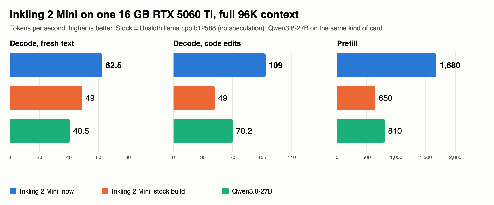

# Inkling 2 Mini on a 16 GB RTX 5060 Ti: 96K context, 62 tok/s decode, 1.7K tok/s prefill



*Numbers measured 2026-11-21/22 on one RTX 5060 Ti 16 GB (Windows, CUDA 13.5, sm_120).*

**TL;DR:** we run Inkling 2 Mini at the full 96K context on one 16 GB card, with about 2 GB of VRAM to spare.
Compared with the stock llama.cpp build we started from, prefill is about 2.5× faster, fresh-text decode is about
25% faster, and code-edit decode is about 2× faster. On our coding and game-building tests it now matches or beats
Qwen3.8-27B served on the same kind of card, while running 1.5–2× faster.

## Where we started vs. where we are

Same card, same Unsloth UD-IQ3_XXS weights (10.85 GiB) plus the F16 vision projector, 96K context.

| | Stock build (Unsloth llama.cpp b12588) | Now |
|---|---|---|
| Decode, fresh text (tok/s) | ~49 | **62.5** |
| Decode, code edits (tok/s) | ~49 (no speculation) | **108–110** |
| Prefill (tok/s, 3K–37K prompt) | ~650 | **~1,680** |
| Decode with 37K already in context (tok/s) | — | **50** |
| 20K-token first chat turn (s) | — | **12.4** |
| Follow-up turn in a growing chat (s) | 2.3 | **1.0** |
| Compute buffer at 96K | grows with context (4.8 GB at ub256) | **535 MiB** (ub1024) |
| VRAM in use, idle | 15.6 of 16.3 GB | **14.15 GB** |
| Needle (3 codes × 3 at 37.5K) / math 30 / tool calls 5 | — | 9/9, 30/30, 5/5 |

## What made the difference

1. **realugbun's Inkling 2 speed fork of llama.cpp.** It fuses the Inkling 2 glue op chains and builds the
   normalized depth states once. llama-bench, fork vs stock: pp512 1574 vs 881, tg128 72 vs 56 (depth 0). It needs
   the mainline-layout GGUF.
2. **Banded relative-bias attention (a port of Unsloth's ggml work, their #378/#386).** The Inkling 2 attention
   path used to build a dense n_kv × n_tokens × n_head bias. That made the compute buffer grow with context, which
   forced a tiny ubatch (128) on 16 GB and capped prefill. With the banded `FLASH_ATTN_EXT_BANDED` op (quantized
   K/V read in-tile), the compute buffer is flat at 535 MiB, ubatch 1024 fits, and prefill doubles.
   - **Bug found while porting:** `llama_kv_cache_context::lctx` was left uninitialized. At startup it made the
     server randomly reserve the dense path: 2.4 GB at ub128, 20 GB at ub1024, OOM at ub512. If you see random
     OOMs or a randomly huge compute buffer on a banded build, check this first.
   - **Kernel fix:** the banded bias branches were compiled into every dense MMA flash-attention instance,
     including the small batches that speculative verification uses. Making `banded` a compile-time template
     variant keeps the dense kernels clean. Code-edit decode went from 102.5 to 108.3 tok/s, measured back to back.
   - Kernel tests on the 5060 Ti: `FLASH_ATTN_EXT_BANDED` 71/71, dense `FLASH_ATTN_EXT` 4430/4430.
3. **ngram speculation (`--spec-type ngram-mod`).** It costs no extra VRAM and gives nearly 2× on edit-style output,
   where the model rewrites text that's already in context. We also tried a DSpark drafter on the stock build; at
   96K it spilled out of VRAM, and at 64K it ran at 39.7 tok/s. ngram-mod was the clear winner on 16 GB.
4. **q8_0 K/V and context checkpoints.** f16 KV gave no decode gain, cost 25–37% of prefill, and could spill.
   `--checkpoint-min-step 1024 --ctx-checkpoints 64` lets a growing chat reuse its prompt cache.

## Server command

```
llama-server --model Inkling-2-Mini-UD-IQ3_XXS.gguf --mmproj mmproj-F16.gguf --jinja \
  --ctx-size 98304 --n-gpu-layers 99 --parallel 1 \
  --temp 1.0 --top-p 1.0 --top-k 0 --min-p 0.0 \
  --ubatch-size 1024 -ctk q8_0 -ctv q8_0 -fa on \
  --checkpoint-min-step 1024 --ctx-checkpoints 64 \
  --spec-type ngram-mod
```

- **Code:** branch `inkling2-speed-banded` of this repository (forked from realugbun/llama.cpp).
  Key commits: `5ce07779b` (banded port), `bbb314845` (lctx fix), `c88454c83` (compile-time banded variant).
  A GitHub Actions workflow (`inkling-win-cuda.yml`) builds the Windows CUDA sm_120 binaries.
- **Multi-GPU boxes:** set `CUDA_DEVICE_ORDER=PCI_BUS_ID` and `CUDA_VISIBLE_DEVICES=<n>`. Otherwise llama.cpp spreads
  across every card, and decode drops to about 28 tok/s.
- **Reasoning:** Inkling uses `chat_template_kwargs.reasoning_effort`, not `enable_thinking`. We use `low` for agent
  work. Keep it fixed for a session, because changing it busts the prompt cache.

## Against Qwen3.8-27B on the same kind of card

The 27B is served with ExLlamaV3 at 2.5 bpw on a second 5060 Ti. Both models ran the same client and the same
suite.

| | Inkling 2 Mini | Qwen3.8-27B |
|---|---|---|
| Decode, fresh text (tok/s) | **62.5** | 40.5 |
| Decode, code edits (tok/s) | **108–110** | 70.2 |
| Prefill (tok/s) | **1,680** | 770–850 |
| Decode with long context (tok/s) | **50.0** | 35.7 |
| Math 30 / tool calls 5 | 30/30, 5/5 | 30/30, 5/5 |
| Max context | 96K | 176K |

Qwen's tokenizer uses about 13% fewer tokens for the same text, so per unit of text the prefill gap is about 1.9×.

**Agentic game building.** An agent builds a browser game from a prompt. It is scored by a scripted playtest plus
an LLM judge. Both models used the same agent harness, 2 builds per game, and a 45-minute cap.

| Game | Inkling 2 Mini | Qwen3.8-27B |
|---|---|---|
| Tic-tac-toe + Connect 4 | 93/93 | 93/93 |
| 3D kart racer | **77** (77, 77) | 61 (77, 45) |
| 3D FPS | **58** (70, 45) | 31 (45, 17) |

Run-to-run spread is 25–32 points, so the fair reading is that Inkling at least matches the 27B here, not that it
wins by 16–27 points.

## Lessons from measuring

- **Time decode on the server.** Some engines don't stream reasoning tokens. If you time decode from the first
  visible token, those engines look 2–3× faster than they are. Use the server's `timings` instead.
- **Check for shared-memory spill.** On Windows, a config that "fits" can quietly spill into shared (system)
  memory, and decode drops to 4–25 tok/s. Not all "shared" memory use is a spill: pinned host staging buffers show
  up there too. To tell them apart, restart with `GGML_CUDA_NO_PINNED=1`. If shared use drops to about 0, it was
  staging, not a spill.
- **Restart before measuring.** A long-running llama-server crept into shared memory after long contexts and lost
  about 25% of its prefill speed. Measure every server freshly started.
- **Compare within one window.** Code-edit decode with ngram speculation swings about ±8% between test windows.
  The "11% regression" we first saw from the banded port was noise. Compare builds back to back in the same window.
- **Agent harness setting:** with a 96K window and the default 64K headroom, our agent harness auto-compacted on
  every step. That was 66% of build time, and it missed the cache each time. Set the compaction headroom so that
  a 96K model compacts at about 64K.

## Credits

- realugbun: the Inkling 2 llama.cpp speed fork.
- Unsloth: the GGUF quants and the banded attention ggml layer.
- The llama.cpp contributors.
